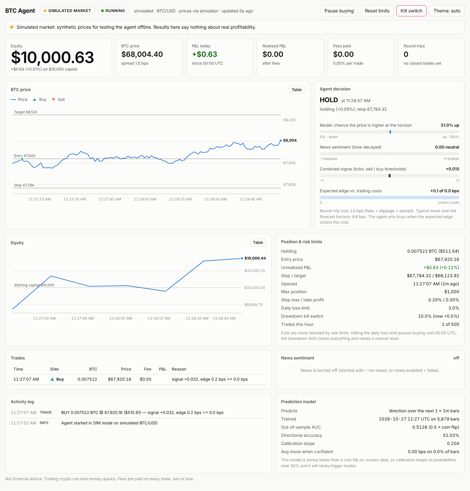

# BTC Agent

An autonomous Bitcoin trading agent with a live dashboard. It:

- **watches the market live:** prices stream in every second over the exchange's WebSocket, with REST polling as an automatic fallback,
- **reads the news:** crypto headlines are pulled from RSS feeds and scored instantly by a built-in lexicon, then refined by **Claude** for context when you add an API key,
- **predicts the next move** with a trained, validated and calibrated machine-learning model,
- **decides every few seconds** whether to buy, hold or sell, and only trades when the expected move pays for the fees,
- **protects your money** with hard risk limits: a mandatory stop loss, position caps, a daily loss limit, a drawdown kill switch, rate limits and a news-shock pause,
- **starts in paper trading** (simulated money on real prices). Live trading needs three separate explicit opt-ins.


*The dashboard running on the built-in simulated market (`btcagent run --sim`), holding a position with its entry, stop and target marked.*

---

## Read this first: what to expect

No software can promise profits, and most short-term trading strategies lose money once fees are counted. This project is built to tell you honestly whether an edge exists, and to protect your capital when it doesn't.

**Fees decide everything.** Every round trip (buy, then sell) pays the fee twice, plus slippage and the bid/ask spread:

| Fee per trade (typical entry-level taker fees; check your exchange) | Round-trip cost incl. 2 bps slippage each way |
|---|---|
| 0.60% (e.g. Coinbase Advanced, lowest tier) | ~1.24% |
| 0.40% (e.g. Kraken Pro, lowest tier) | ~0.84% |
| 0.10% (e.g. Binance spot) | ~0.24% |
| 0.00% (maker rebates / promotions) | ~0.04% + spread |

Bitcoin typically moves roughly 0.1–0.3% in 15 minutes, depending on volatility. `btcagent train` prints the real number for your data. A strategy that turns over every few seconds or minutes therefore can't overcome a 0.4–0.6% fee. So the agent **re-evaluates every 5 seconds but buys only when its expected edge covers the full round-trip cost** (`strategy.min_edge_multiple`). With retail fees you will see it hold most of the time. That's the agent protecting you, not a bug: the dashboard always shows the exact reason.

**On news speed:** RSS headlines arrive seconds to minutes after an event, while professional firms react in milliseconds. News works here as context and a risk filter: it can pause buying and exit positions on a strongly negative shock. It isn't a speed advantage.

**Recommended path:** run the simulator → download data → train → backtest → paper trade for weeks → only then consider small live amounts.

---

## Quick start

Requires Python 3.11+.

```bash
python -m venv .venv && source .venv/bin/activate
pip install -e ".[dev]"
cp .env.example .env          # optional: add ANTHROPIC_API_KEY for Claude news scoring

btcagent run --sim            # 1. offline demo on a simulated market -> http://localhost:8000
btcagent download             # 2. download 60 days of real 1-minute BTC bars
btcagent train                # 3. train and validate the prediction model
btcagent backtest             # 4. out-of-sample backtest plus a fee-sensitivity table
btcagent run                  # 5. paper trade on live prices -> http://localhost:8000
```

`btcagent news` fetches and scores the current headlines once, which is handy for checking your news setup.

Any setting can be overridden from the command line without editing `config.toml`:

```bash
btcagent run --set trading.fee_rate=0.001 --set risk.max_position_usd=250
btcagent --set exchange.id=kraken --set exchange.symbol=BTC/USD run
```

---

## How it works

```
 Exchange WebSocket ── ticks (every second) ──────────────────────┐
 Exchange REST ─────── 1-minute bars ── features ── model P(up) ──┤
 RSS feeds ── lexicon score (instant) ── Claude (refines) ────────┤
                                       └── decayed news score ────┤
                                                                  ▼
                      strategy: is the expected move > round-trip cost?
                                                                  ▼
                      risk manager: limits, stops, kill switch, rate limits
                                                                  ▼
                      broker: paper (simulated fills) | live (ccxt orders)
                                                                  ▼
                      SQLite journal + live dashboard (WebSocket)
```

**Every decision cycle** (every 5 s, and immediately when a tick crosses a stop or target):

1. **Data checks:** the price must be fresh (< 15 s old) and the spread sane.
2. **Model:** the calibrated probability that BTC is higher 15 minutes from now (`model.horizon_bars` × `model.timeframe`).
3. **News:** time-decayed sentiment × relevance × impact over recent headlines; a story's weight halves every 90 minutes.
4. **Signal:** `0.75 × model + 0.25 × news`, in −1 … +1.
5. **Edge test:** `signal × expected move` must reach `min_edge_multiple × (2 × fee + 2 × slippage + spread)`.
6. **Risk manager:** may block the trade, size it, or force an exit.
7. **Execute and record:** the broker fills the order, the ledger and SQLite journal update, and the dashboard refreshes.

It trades **spot, long-only**: it buys BTC when it expects a rise and sells back to cash. There's no leverage or shorting, by design.

### Risk controls

| Control | Default | What happens |
|---|---|---|
| Stop loss (mandatory) | 1% | Sells as soon as the price is 1% below entry; checked on every tick |
| Take profit | 2% | Sells at +2% (0 disables) |
| Trailing stop | off | Sells if the price falls N% from its peak since entry |
| Max holding time | 240 min | Closes stale positions |
| Max position | $1,000 and 50% of equity | Hard caps on any single position |
| Daily loss limit | 3% | Sells and pauses buying until 00:00 UTC |
| Drawdown kill switch | 10% from peak | Sells everything and halts until you press **Reset limits** |
| Trade rate limits | 12 per hour, 30 s apart | Throttles entries only; exits are never blocked |
| Stale-data guard | 15 s | Never opens a trade on an old price |
| Spread guard | 20 bps | Never buys into a thin market |
| News shock | news score ≤ −0.5 | Sells and pauses buying for 30 minutes |
| Kill switch button | — | Dashboard button: sell everything at market, halt until reset |

In live mode the agent keeps its **own books**: it never spends more than `trading.capital_usd`, never more than your free balance, and **only sells BTC it bought itself**, never coins that were already in your account. State is saved to `data/journal.db`, so a restart resumes where it left off.

---

## The prediction model

- **Data:** 1-minute OHLCV bars from your exchange (`btcagent download`, cached in `data/` and updated incrementally).
- **Features** (identical in training and live trading, with no look-ahead): returns over 1–60 bars, volatility and its regime, RSI, MACD, Bollinger position, distance from the moving average, bar range, close position, volume z-score and time of day.
- **Model:** a small, heavily regularised gradient-boosted classifier (scikit-learn) that predicts whether the price will be higher after the horizon.
- **Validation:** purged walk-forward. Every reported score is measured on data that comes strictly after the training data, with a gap so labels can't leak.
- **Calibration:** probabilities are re-fitted on those out-of-sample predictions. A model with no real skill gets its probabilities pulled back to ~50%, so **the agent cannot trade on false confidence.** `btcagent train` warns when the AUC is close to a coin flip.
- **Retraining:** run `btcagent download && btcagent train` periodically, or set `model.retrain_every_hours`. The agent then retrains in the background and swaps in the new model only if it validates at least as well.

`btcagent backtest` trains on everything before the last 7 days and simulates those unseen 7 days with the same strategy, risk and fee code the live agent uses. It reports return vs. buy-and-hold, drawdown, Sharpe ratio, win rate and fees, plus a table showing how the results change across fee levels. Backtests have no historical news, so the news signal is neutral there.

---

## News analysis with Claude

With `ANTHROPIC_API_KEY` set in `.env` (or `news.claude = "on"`), each new headline is:

1. scored **instantly** by the lexicon, so trading never waits on an API call, then
2. sent in batches to **Claude** (`news.claude_model`, default `claude-opus-5-5`, at `low` effort, because this is a classification task), which returns structured JSON: sentiment (−1 … +1), relevance to bitcoin, likely market impact and a one-line rationale. Claude's scores replace the lexicon's within seconds.

Requests use structured outputs, so the response always matches a JSON schema, and Anthropic's server-side refusal fallback (`fallbacks: "default"`). Any problem (missing or invalid key, network error, rate limit, refusal or malformed output) leaves the lexicon scores in place: the agent keeps running either way. Headlines are treated as untrusted data, and the scores are clamped to their valid ranges. Old stories (> 4.5 h with the default half-life) aren't sent at all, to save cost. To use a cheaper model, set for example `news.claude_model = "claude-haiku-5-5"`.

---

## Going live

Only after paper trading has convinced you. Then:

1. Create an exchange API key with **trade + view permissions only. Never enable withdrawals.** Restrict it to your server's IP if your exchange supports that.
2. Put the key in `.env` (`EXCHANGE_API_KEY`, `EXCHANGE_API_SECRET`, and `EXCHANGE_API_PASSWORD` where needed). Coinbase CDP secrets are multi-line PEM keys: wrap the value in double quotes and keep the `\n` line breaks.
3. Set `trading.fee_rate` to your real fee tier, and `trading.capital_usd` to an amount you can afford to lose.
4. Set `mode = "live"` in `config.toml` **and** `BTCAGENT_LIVE_CONFIRM=I_ACCEPT_THE_RISK` in `.env`. Without both (and the keys), the agent refuses to start.
5. Run it 24/7 on a server, not a laptop that sleeps. **While the agent isn't running, its stop loss isn't enforced.** Use `--flatten-on-exit` if you'd rather it sell on shutdown.

Example systemd unit (`/etc/systemd/system/btcagent.service`):

```ini
[Unit]
Description=BTC trading agent
After=network-online.target

[Service]
WorkingDirectory=/opt/btcagent
ExecStart=/opt/btcagent/.venv/bin/btcagent run
Restart=on-failure
RestartSec=10

[Install]
WantedBy=multi-user.target
```

To view the dashboard remotely, prefer an SSH tunnel (`ssh -L 8000:localhost:8000 server`). If you bind it to a public address instead, `DASHBOARD_TOKEN` is mandatory and you open `http://host:8000/?token=…`.

**Exchanges:** any [ccxt](https://github.com/ccxt/ccxt) exchange id works (`coinbase`, `kraken`, `binance`, `binanceus`, `bitstamp`, `gemini`, …). Use `BTC/USDT` where the exchange quotes in USDT. Kraken's OHLC endpoint only serves the most recent 720 bars, so for training data use `btcagent download --exchange coinbase` (or bitstamp) and keep trading on Kraken.

---

## Project layout

```
btcagent/
  cli.py            commands: download, train, backtest, run, news
  config.py         config.toml + .env loading and validation (unknown keys are rejected)
  engine.py         the agent: tick, bar, decision, news, snapshot and retrain loops
  features.py       leak-free feature engineering (shared by training and live)
  model.py          training, walk-forward validation, calibration
  strategy.py       signal blending and the edge-vs-cost test
  risk.py           every risk rule
  ledger.py         the agent's own books (cash, position, P&L, fees)
  backtest.py       bar-by-bar backtest that reuses strategy/risk/ledger
  storage.py        SQLite journal (trades, equity, news, resumable state)
  market/           ccxt exchange access, live feeds, history, simulator
  news/             RSS sources, lexicon scorer, Claude scorer, decayed signal
  broker/           paper and live (ccxt) order execution
  web/              FastAPI dashboard server and the single-page UI
tests/              pytest suite
config.toml         every setting, documented inline
```

## Tests

```bash
pytest
```

The suite covers config validation, look-ahead-free features, model calibration on data with and without a learnable pattern, the lexicon and news pipeline, the Claude scorer (run through the real Anthropic SDK against a mocked HTTP transport), every risk rule, ledger accounting, the paper and live brokers (against a fake exchange), backtest accounting and gap-through-stop fills, the agent's decision loop (stops, news shocks, kill switch, pause, restart and resume) and the dashboard's security checks.

## Limitations and ideas

- Market orders only. Post-only limit orders (maker fees) would cut costs substantially.
- The news signal can't be backtested without a historical news archive. Recording live sentiment alongside prices would let a future model learn from it.
- One symbol, spot, long-only.
- Ideas: maker orders, alerts (Telegram/email), multi-timeframe models, an exchange-side stop order as a backstop while the agent is offline.

## Disclaimer

This is software, not financial advice. Crypto is volatile, and you can lose money quickly, including through fees, slippage, outages and bugs. Paper trade first, never risk money you can't afford to lose, and check your local regulations.
